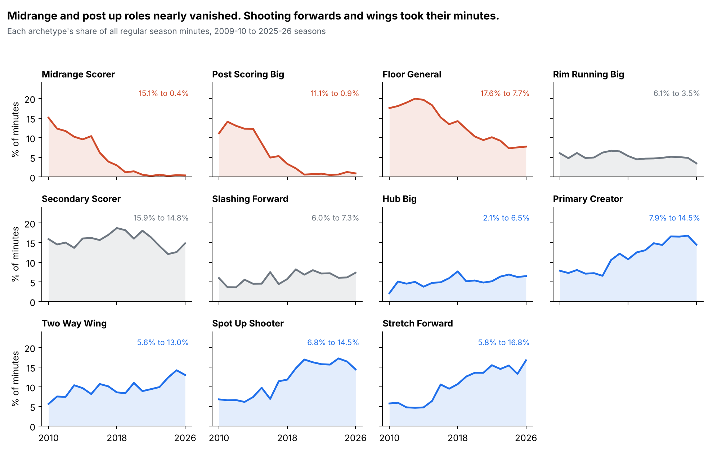
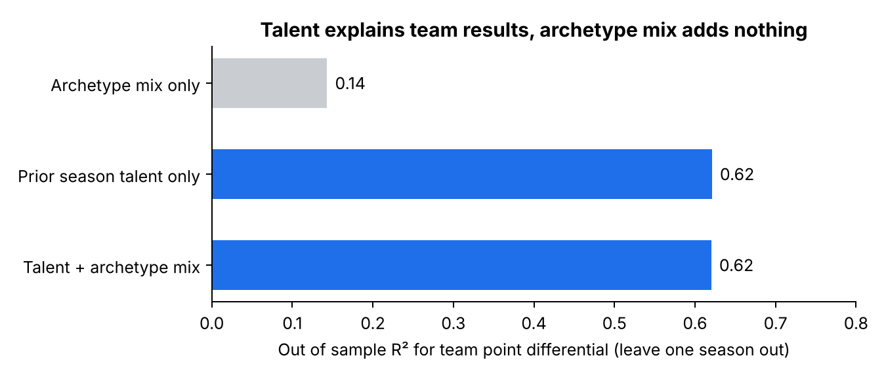
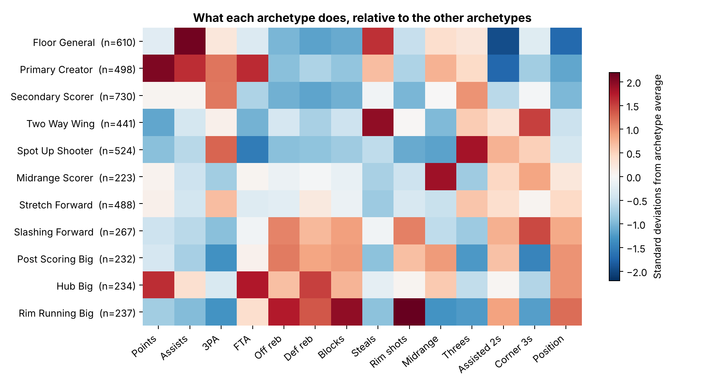

# NBA Player Archetypes

Clustering 6,948 NBA player seasons (2009-10 through 2025-26) into 11 roles by **how** a player plays, then asking two questions with them:

1. How has the league's mix of roles changed?
2. Does a team's mix of roles predict winning once you account for how good its players are?

**Live explorer:** look up any player season and its 10 closest statistical comps → `docs/index.html` (served with GitHub Pages)



## Findings

**The midrange and post up game disappeared.** Midrange Scorers fell from 15.1% of league minutes in 2010 to 0.4% in 2026. Post Scoring Bigs fell from 11.1% to 0.9%. Stretch Forwards (5.8% to 16.8%), Spot Up Shooters (6.8% to 14.5%), and Two Way Wings (5.6% to 13.0%) took those minutes.

**Role mix does not predict team success beyond talent.** Across 240 team seasons (2014-15 to 2021-22), minute weighted prior season player ratings explain 62% of the variance in team point differential, tested out of sample by holding out one season at a time. Adding the archetype mix moves that to 62% (0.621 to 0.620). Archetype mix alone explains 14%, but that signal disappears once talent is in the model. No single archetype's minute share is significant at p < 0.05 after controlling for talent.



**The similarity engine finds real comps.** A player's role changes slowly from year to year, so a good similarity space should place a player's next season near the current one. For 5,311 consecutive season pairs, the next season ranked in the top 1% most similar of all 6,947 other player seasons 74% of the time, and in the top 5% 91% of the time.

## The 11 archetypes



| Group | Archetypes |
|---|---|
| Guards | Primary Creator, Floor General, Secondary Scorer |
| Wings | Spot Up Shooter, Two Way Wing, Midrange Scorer |
| Forwards | Stretch Forward, Slashing Forward |
| Bigs | Hub Big, Post Scoring Big, Rim Running Big |

## Method

**Data.** Basketball Reference per 100 possession, shooting location, and play by play tables via the public [sumitrodatta/bball-reference-datasets](https://github.com/sumitrodatta/bball-reference-datasets) repo. Team results from [NocturneBear/NBA-Data-2010-2024](https://github.com/NocturneBear/NBA-Data-2010-2024). Player ratings from [FiveThirtyEight RAPTOR](https://github.com/fivethirtyeight/data/tree/master/nba-raptor). Traded players use their season total row.

**Features (22).** Per 100 possession rates (points, shots, threes, free throws, rebounds, assists, steals, blocks, turnovers, fouls), shot location shares, share of makes that were assisted, dunk and corner three shares, and a 1 (PG) to 5 (C) position index. Shooting percentages are left out on purpose so the clusters describe role, not quality.

**Clustering.** Standardize, PCA to 10 components (91% of variance), KMeans on the 4,484 seasons with at least 1,000 minutes. Seasons with 250+ minutes are then assigned to the nearest centroid.

**Choosing k.** Tested k from 4 to 14 using silhouette score and bootstrap stability (refit on 80% subsamples, compare to the full fit with adjusted Rand index). k = 11 kept stability at 0.87 while giving roles a scout would recognize. Silhouette scores are low at every k (0.12 to 0.21), which says player roles form a continuum more than distinct groups. Ward hierarchical clustering agrees with KMeans at ARI 0.40, the same picture.

**Naming.** Each name has a prototype stat profile. Clusters get names by optimal one to one matching (Hungarian algorithm), so names stay attached to the right cluster if a refit reorders cluster ids.

**Team model.** For each team season, the share of minutes played by each archetype, plus a talent score: minute weighted RAPTOR from each player's *previous* season, shrunk toward replacement level by 500 minutes, with rookies at replacement level. Same season RAPTOR is calibrated to team results, so it would leak the answer into the predictor. A first version that used it produced an R² of 0.98, which is how the leak showed up. Ridge regression, leave one season out cross validation.

## Limitations

* Box score and location data only. No tracking data, so defense is described by steals, blocks, and rebounds.
* Archetypes are fit on one season at a time. A player who changes roles mid season gets an average.
* The team model uses minutes from the season being predicted, which coaches choose partly in response to results.
* 240 team seasons is a small sample for 11 composition variables. A real effect of a few tenths of a point per game could hide here.

## Run it

```bash
pip install -r requirements.txt
bash download_data.sh
python src/cluster.py         # k selection table → output/k_selection.csv
python src/analysis.py        # clusters, similarity validation, team model → output/
python src/charts.py          # figures/
python src/export_explorer.py # docs/index.html
```
